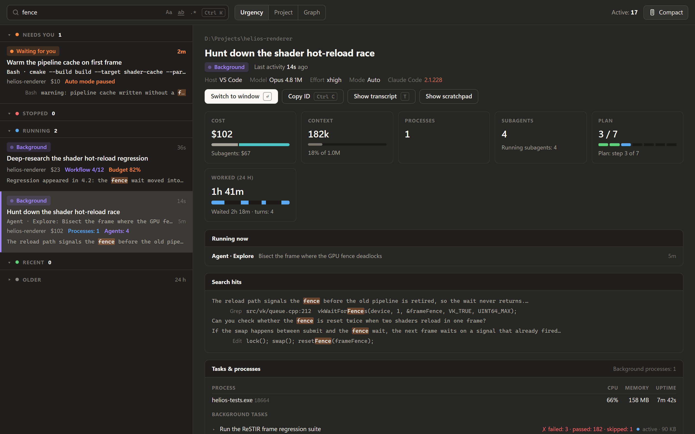
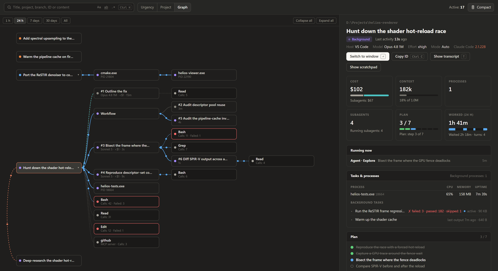
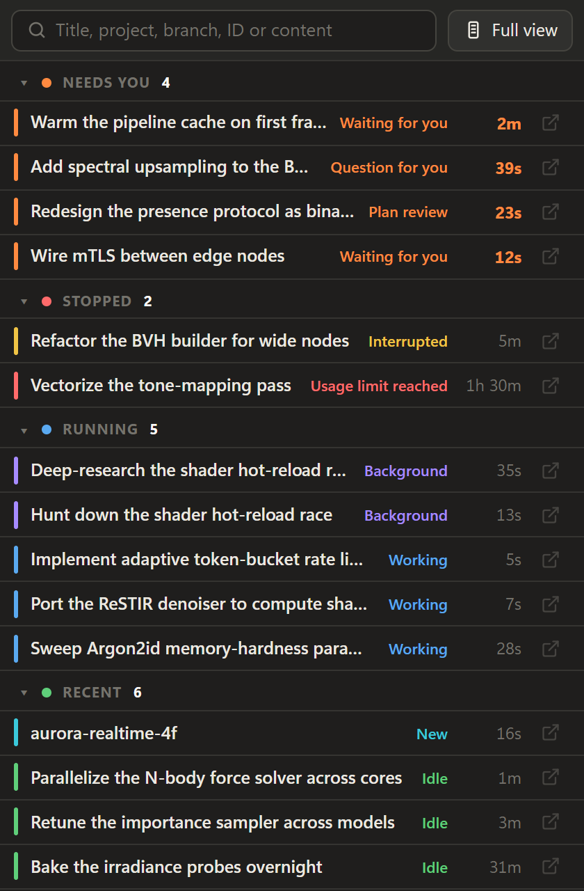

# Agent Monitor for Claude

A local desktop window that shows every running Claude Code agent at a glance - grouped by project, with each agent's live status: working, waiting for you, blocked on a permission prompt, or finished.


## Features

### Overview
- **Who needs you, first** - the list is sorted into *Needs you* (a question, a plan to review, a permission prompt), *Stopped* (an error, a usage limit, an interrupt), *Running*, *Recent* and *Older*. Click a section header to fold it. The *Project* grouping shows the same sessions per project, with their cost. Claude Desktop chats without a project folder are listed under *This computer*.
- **Status in words** - *working*, *retrying*, *waiting for you*, *question for you*, *plan review*, *blocked*, *interrupted*, *error* (with its cause, e.g. *error: servers overloaded*, or a countdown to a usage limit's reset), *wakes in 4m* for a `/loop`, or *finished*, with the time since the last activity.
- **What it is doing** - each entry shows in one line what the agent waits on, what it is running, or the first line of its last answer.
- **Signals** - each entry shows up to two of: unfinished git work (uncommitted, not pushed, local-only or deleted branch), running processes, subagents or workflow progress, a budget from 80% spent, Auto mode on hold, an available Claude Code update, and queued prompts.
- **Cost** - an estimated dollar cost per session, including subagents and web searches. Prices are in an editable `pricing.json` (see [docs/configuration.md](docs/configuration.md)).

### Details
Select a session to see its details beside the list:

- status with its reason, host, model, effort, mode and Claude Code version
- cost breakdown, context, budget, prompt cache, lines changed, and a timeline of when it worked and waited
- plan steps, the full command or question it waits on, and its whole last answer - formatted as Markdown or as written
- its tool calls with their inputs and results, images from the conversation, artifacts and pull requests
- **uncommitted changes** in its working directory - click a file to see its diff (needs `git` on your `PATH`)
- **processes** with live CPU, memory and running time, and **background tasks** - expand one to follow its output. Test results (pytest, unittest, Jest, Vitest, Node, cargo, go test) are shown without expanding.
- failed hooks with their command and output, and a link to the branch on GitHub, GitLab, Bitbucket or Gitea

Buttons switch to the session's window, copy its session ID, show its transcript or scratchpad in your file manager, or copy the `claude attach` command of a background agent. Drag the line between list and details to resize them. Below 800 pixels, the details replace the list; *Esc* goes back.


### Search
One field finds sessions by title, project, branch or session ID while you type, and by transcript content a moment later. Each entry shows its first hit; the details show up to five. Match case, whole word and regular expression are supported. *Ctrl+K* focuses the field, *Esc* clears it. The search covers the open sections; if nothing matches, it offers to widen the search. See [PRIVACY.md](PRIVACY.md) for what it reads.



### Connection graph
The *Graph* grouping draws each session with its subagents, workflows, background processes, the tools they called, and the messages between sessions. Click a node to see it in the details - a subagent's task, result and tool calls, or a process's command line and live figures. Choose a time window from an hour to everything, drag to pan, and fold a session's subtree with its arrow. A legend explains the lines and marks.



### More
- **Jump to a session** - double-click or press *Enter* to bring its window to the front; for the VS Code extension the exact session tab is focused. *J*/*K* or the arrow keys move through the list, *Ctrl+C* copies the session ID, *T* shows the transcript. Right-click for the menu.
- **Older sessions** - the *Older* section (closed by default) lists past sessions within a time window you choose (24 hours by default). You can delete a past session's files from there after a confirmation. This is the only change the app makes to your Claude Code data.
- **Compact view** - a narrow strip that stays on top of other windows, one line per session. A click switches to the session's window.

  

- **Taskbar** - on Windows the taskbar button shows how many sessions wait for you. On Linux the window asks for attention.
- **WSL** - on Windows, sessions running inside WSL distributions are listed too.
- **13 languages** - English, German, Spanish, French, Hindi, Indonesian, Italian, Japanese, Korean, Brazilian Portuguese, Ukrainian, Simplified and Traditional Chinese, detected from your system locale.
- **No setup** - a single executable on Windows. It finds your Claude config directory on its own (honors `CLAUDE_CONFIG_DIR`). An optional settings file adjusts the refresh interval and window size.

## Requirements

- Windows 10 / 11, or Linux with a freedesktop desktop environment (see [Linux](#linux) below)
- Claude Code (this tool reads the session data it writes under `~/.claude/`)
- On Windows: the [Microsoft Edge WebView2 runtime](https://developer.microsoft.com/microsoft-edge/webview2/), pre-installed on current Windows
- For WSL sessions: WSL2 with the `\\wsl.localhost` share (Windows 11, or Windows 10 with WSL from the Microsoft Store)
- Python 3.10 or newer - required on Linux, and on Windows only to run or build from source; the prebuilt executable bundles its own Python

## Getting started

### Windows
Download `AgentMonitorForClaude.exe` from the [latest release](https://github.com/jens-duttke/agent-monitor-for-claude/releases) and run it. No installation. The executable is signed by *Jens Duttke*.

To run it from source instead (Python 3.10 or newer, check with `python --version`):

```sh
python -m venv .venv
.venv\Scripts\python -m pip install -r requirements.txt
.venv\Scripts\python -m agent_monitor_for_claude
```

If your Python is older, install a current one from [python.org](https://www.python.org/downloads/windows/), delete any existing `.venv`, and create it with the new Python's full path (for example `C:\Users\you\AppData\Local\Programs\Python\Python313\python.exe -m venv .venv`).

### Linux
There is no prebuilt binary; the app runs from source. Tested on Ubuntu with GNOME.

```sh
sudo apt install python3-venv python3-gi gir1.2-webkit2-4.1

git clone https://github.com/jens-duttke/agent-monitor-for-claude.git
cd agent-monitor-for-claude

python3 -m venv --system-site-packages .venv
.venv/bin/pip install -r requirements.txt

./agent-monitor-for-claude
```

The last line starts the app, from any directory. To add it to your desktop's application launcher:

```sh
linux/install-desktop-entry
```

Run it again if you move the checkout. To start the app from any terminal, link the launcher onto your PATH:

```sh
ln -s ~/agent-monitor-for-claude/agent-monitor-for-claude ~/.local/bin/agent-monitor-for-claude
```

Notes:

- **The virtual environment needs `--system-site-packages`**, or the app stops with `No module named 'gi'`. For an existing `.venv`, set `include-system-site-packages = true` in `.venv/pyvenv.cfg`.
- **Windows of native Wayland apps cannot be brought to the front.** VS Code and most terminals run under XWayland and work as usual.

### Uninstalling
On Windows, delete the executable. On Linux, run `linux/install-desktop-entry --remove` if you added the desktop entry, then delete the checkout and its `.venv`.

To remove your interface preferences as well, delete `%LOCALAPPDATA%\AgentMonitorForClaude` (Windows) or `~/.local/share/agent-monitor-for-claude` (Linux).

## Configuration

All settings are optional. See [docs/configuration.md](docs/configuration.md) for the full reference and the settings-file search order.

## How it works

Agent Monitor reads the session files Claude Code writes locally and the process list. See [docs/how-it-works.md](docs/how-it-works.md).

## Privacy

No network connections, no credentials, no telemetry. Apart from a session deletion you confirm, it writes only its own files. See [PRIVACY.md](PRIVACY.md).

## Building

The executable is built on Windows with PyInstaller:

```sh
.venv\Scripts\pip install -r requirements-dev.txt
.venv\Scripts\python build.py
```
Produces `dist/AgentMonitorForClaude.exe`. There is no Linux equivalent - run the app from source there.

Your own build is unsigned. To sign it, install the Windows SDK signing tools and put a `signing.env` next to `build.py` with `SIGNING_THUMBPRINT` (a certificate in your Windows certificate store) and `SIGNING_TIMESTAMP_URL`.

## Developing

To work on the UI in a browser, open `agent_monitor_for_claude/ui/index.html?mock`. It shows the sample data from `ui/dev-mock.js`, which is not part of the built executable.

To refresh the screenshots in `docs/images/`, run `node tools/screenshots.mjs` (optionally with scene names: `overview`, `graph`, `search`, `compact`). It needs Edge or Chrome; set `SCREENSHOT_BROWSER` if it finds neither.

Run the tests with `python -m unittest discover -s tests` and `node --test tests/js/logic.test.js tests/js/global-scope.test.js`.

## License

[MIT](LICENSE) (c) Jens Duttke
