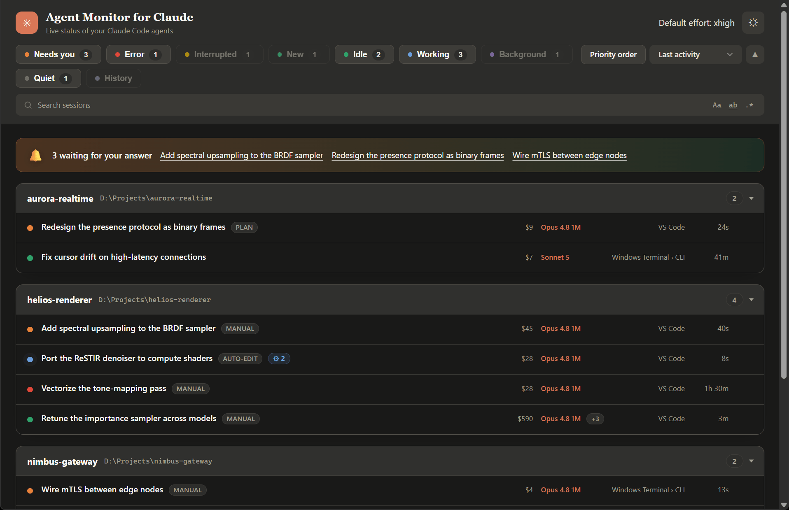

# Agent Monitor for Claude

A local desktop window that shows every running Claude Code agent at a glance - grouped by project, with each agent's live status: working, waiting for you, blocked on a permission prompt, or finished.

If you run many Claude Code agents across several projects, you cannot tell from the IDE which one is actually doing something and which is quietly waiting for you. Agent Monitor answers that in one glance.

> [!IMPORTANT]
> This project is still in an early stage. Detailed issue reports - with steps to reproduce, what you expected, and what actually happened - are very welcome and help a lot.



## Features

### It just works
- **Portable on Windows** - a single executable, no installation. On Linux it runs from source against the GTK and WebKit libraries your desktop already ships.
- **Zero configuration** - it finds your Claude config directory automatically (honors `CLAUDE_CONFIG_DIR`).

### What you see every day
- **Who needs you, first** - the list sorts every running Claude Code agent by what it asks of you: *Needs you* (a question, a plan to review, a permission prompt - the longest wait on top, with a clock counting up), *Stopped* (an error, a usage limit, or you interrupted it), *Running*, *Recent*, and *Older*. Click a section's header to fold it away. Switch the grouping to *Project* to see the same agents per project, each project with its cost. Claude Desktop chats without a project folder are listed together under *This computer*.
- **Everything about one agent, without hovering** - select an agent and the details beside the list show its status with the reason behind it, its host, model, effort, mode and Claude Code version, and buttons to switch to its window, copy its session ID, show its transcript or scratchpad in your file manager, or copy the `claude attach` command of a background agent. Below follow its figures - cost, context, processes, subagents, plan step, budget, prompt cache, lines changed, and how long it worked and waited over the last day with a timeline - and blocks for its plan steps, its uncommitted changes, its processes, subagents, cost breakdown and session - with links to the artifacts and pull requests it produced, and the first error line of a failing hook. Drag the line between the list and the details to change their widths. Below 800 pixels a click shows the details in place of the list; *Esc* goes back.
- **Status in words** - every agent says what it is doing: *working* (or *retrying* while Claude Code retries a failed request), *waiting for you*, *question for you*, *plan review*, *blocked* (a Claude Desktop agent that needs your decision), *interrupted*, *error* (named as far as the error says, e.g. *error: servers overloaded*, and for a usage limit with a countdown to its reset), *wakes in 4m* for a self-paced `/loop`, or *finished*, with the time since its last activity. The details add the error's own message, what started the running turn, and how long the agent has been in its status.
- **What it is doing, in one line** - under its title, every entry says what the agent waits on (the command a permission prompt is about, the question it asks, the plan to review), what it runs right now with a running clock, or the first line of its last answer. The details show the full command, the question with its answers, the plan text, or the whole last answer.
- **The two facts that matter, on every entry** - next to the cost, an entry names up to two of: running processes, subagents or a workflow's progress, a context from 80% full, a budget from 80% spent, a lapsed prompt cache your next prompt pays for (from $1), Auto mode put on hold after three blocked calls, a newer Claude Code a restart would bring, failing hooks, and queued prompts.
- **Search** - one field finds sessions by title, project, branch or the start of a session ID as you type, and by what their transcripts contain a moment later: message text, reasoning, tool calls and their results. An entry says why it matched, and shows the first hit with the text around it; the details show up to five, labelled with where each came from. Match case, whole word and regular expression work as in your editor. *Ctrl+K* jumps into the field, *Esc* clears it. The content search reads only the open sections. If nothing matches, the empty result offers to look wider, one step per click - first the closed sections, then a longer time window. What it reads and how much of it can ever be shown is bounded - see [PRIVACY.md](PRIVACY.md).
- **Background processes and task output** - for an agent running OS processes (a watched build, a scan), the details show a live table with CPU, memory and running time of each, and its background tasks; expand one to follow its output in a console that keeps the task's colors and lets you copy its text. If the task redirected its output to a file in its own scratchpad or project folder, the console follows that redirect. Output is read only while a task is expanded. A task that ran tests shows how many passed and failed (pytest, unittest, Jest, Vitest, Node's test runner, cargo and go test). For a Windows agent whose tools run through WSL, the table adds the shared WSL2 virtual machine's CPU and memory - a machine-wide figure, since that VM is where the Linux work runs.
- **Uncommitted changes** - for the selected agent, the details list the files in its working directory (or its worktree) that are not committed yet, with the lines each adds and removes, how far the branch is ahead of or behind its upstream, and how many of the files the agent itself edited are still uncommitted. This needs `git` on your `PATH`.
- **Connection graph** - the *Graph* grouping draws the running agents with every subagent they started, grouped under their workflow, each background process under the process that started it, the tools and MCP servers each of them called (for what you select), and the messages between agents and sessions - over a time window you choose, from an hour to everything. Click an agent, a subagent, a process or a tool to see it in the details: a subagent's whole task, its result and every tool call with its request and result, a process's live CPU, memory and uptime; a subagent's tool shows that tool's calls. Dots move along a connection while a subagent runs or a message was just sent; drag the graph to pan it. Replies, plans and tasks can be shown formatted (Markdown) or as written.
- **Cost** - each agent shows an estimated dollar cost that covers its subagents and web searches, priced per model. Its details split it into the main conversation, each kind of subagent, each skill and the web searches, and give the full token breakdown. Prices live in an editable `pricing.json` (see [docs/configuration.md](docs/configuration.md)); a future price change entered under its start date applies on its own.
- **WSL sessions too** - on Windows, Claude Code agents running inside WSL distributions appear alongside your native agents, read over `\\wsl.localhost` with nothing ever executed inside the distro.
- **Jump right to it** - double-click an agent or press *Enter* and its window comes to the foreground; for VS Code extension sessions the exact session tab is focused via the extension's official deep link. Right-click an agent for its menu. *J*/*K* or the arrow keys move through the list, *Ctrl+C* copies the selected session's ID, *T* shows its transcript.
- **Revisit and clean up past sessions** - the *Older* section (closed by default) lists finished sessions that have left the overview - the ones `claude --resume` would show - loaded when you open it. Its buttons set how far back it reaches (1 hour to 30 days, or everything; 24 hours by default). From a past session's details or menu you can permanently delete its transcript and subagent files from disk, after a confirmation that names the session. That deletion is the only change the tool ever makes to your Claude Code data, and a running session is never touched (see [PRIVACY.md](PRIVACY.md)).

### Reach and preferences
- **Compact view** - the *Compact* button turns the window into a narrow strip that stays above all other windows: one line per agent, with its status and time, under the same sections as the full view. A click switches to that agent's window; the symbol at the right end of a line, or a double-click, opens its details in the full view. The full view is never kept on top.
- **On the taskbar** - on Windows the app's taskbar button shows how many agents are waiting for you, and flashes once when another one starts to wait while the window is in the background. On Linux the window asks for attention instead.
- **13 languages** - auto-detected from your system locale (English, German, Spanish, French, Hindi, Indonesian, Italian, Japanese, Korean, Brazilian Portuguese, Ukrainian, Simplified and Traditional Chinese).
- **Customizable** - an optional settings file tunes the poll interval and window size.

## Requirements

- Windows 10 / 11, or Linux with a freedesktop desktop environment (see [Linux](#linux) below)
- Claude Code (this tool reads the session data it writes under `~/.claude/`)
- On Windows: the [Microsoft Edge WebView2 runtime](https://developer.microsoft.com/microsoft-edge/webview2/), pre-installed on current Windows
- WSL sessions need WSL2 with the distro running, plus the `\\wsl.localhost` UNC share that Windows 11 (or Windows 10 with the Microsoft Store version of WSL) exposes for it. On an older inbox WSL build without that share, the feature quietly finds nothing - see [docs/configuration.md](docs/configuration.md) to turn WSL monitoring off
- Python 3.10 or newer - required on Linux, and on Windows only to run or build from source; the prebuilt executable bundles its own Python

## Getting started

### Windows
Download `AgentMonitorForClaude.exe` from the [latest release](https://github.com/jens-duttke/agent-monitor-for-claude/releases) and run it. No installation.
The executable is code signed, so Windows names *Jens Duttke* as its publisher - the file properties show the signature under *Digital Signatures*.

To run it from source instead, check which Python you have first - it has to be 3.10 or newer:

```sh
python --version
```

Then:

```sh
python -m venv .venv
.venv\Scripts\python -m pip install -r requirements.txt
.venv\Scripts\python -m agent_monitor_for_claude
```

If `python --version` reports an older release, install a current one from
[python.org](https://www.python.org/downloads/windows/) and create the environment with its full
path, for example:

```sh
C:\Users\you\AppData\Local\Programs\Python\Python313\python.exe -m venv .venv
```

Do not reach for `py -3` instead - an outdated launcher picks the wrong installation. Delete an
existing `.venv` before you start again: a virtual environment keeps the Python it was created with.

### Linux
There is no prebuilt binary: PyInstaller cannot bundle GTK and WebKit reliably, so the app runs from source against the libraries your desktop already ships. Tested on Ubuntu with GNOME.

```sh
sudo apt install python3-venv python3-gi gir1.2-webkit2-4.1

git clone https://github.com/jens-duttke/agent-monitor-for-claude.git
cd agent-monitor-for-claude

python3 -m venv --system-site-packages .venv
.venv/bin/pip install -r requirements.txt

./agent-monitor-for-claude
```

That last line is the launcher, and it is all you need from then on. It activates nothing and works
from any directory. To start the app from your desktop's application launcher, with its own icon, add
a desktop entry for it:

```sh
linux/install-desktop-entry
```

The entry points at this checkout, so run the script again if you move the checkout. To start the app
from any terminal as well, symlink the launcher onto your PATH:

```sh
ln -s ~/agent-monitor-for-claude/agent-monitor-for-claude ~/.local/bin/agent-monitor-for-claude
```

Two notes specific to Linux:

- **The virtual environment needs `--system-site-packages`.** PyGObject is installed by apt, not by pip; without that flag the app stops at `ModuleNotFoundError: No module named 'gi'`. If you already have a `.venv` created without it, set `include-system-site-packages = true` in `.venv/pyvenv.cfg` rather than recreating it.
- **Bringing an agent's window to the front goes through X11.** Applications drawn by XWayland - which is where VS Code and most terminals still run in a Wayland session - are found and raised as usual. A window belonging to a native Wayland client cannot be raised, because no Wayland protocol lets one application do that; clicking such an agent does nothing. Everything else works the same either way.

### Uninstalling
On Windows, delete the executable. On Linux, run `linux/install-desktop-entry --remove` if you added the desktop entry, then delete the checkout and its `.venv`.

What either leaves behind is your interface preferences (open sections, grouping, compact view, collapsed groups), in `%LOCALAPPDATA%\AgentMonitorForClaude` on Windows and `~/.local/share/agent-monitor-for-claude` on Linux - delete that folder to remove those too. Linux additionally leaves a lock file in the session's runtime directory, which the system clears at logout. There is nothing else: no installer, no registry entries, no service. See [PRIVACY.md](PRIVACY.md).

## Configuration

All settings are optional. See [docs/configuration.md](docs/configuration.md) for the full reference and the settings-file search order.

## How it works

Agent Monitor reads the session registry and transcript metadata that Claude Code writes locally, and derives each agent's state from the last assistant turn's stop reason plus process liveness. See [docs/how-it-works.md](docs/how-it-works.md) for the details.

## Privacy

No outbound network connections, no credentials, no telemetry. Apart from the session deletion described above, it writes only its own files. [PRIVACY.md](PRIVACY.md) states exactly what is read, what is kept, what is shown, and what is written, and lists the commands and tests to verify each claim yourself.

## Building

The standalone executable is a Windows build; it additionally needs PyInstaller, kept out of the runtime requirements:

```sh
.venv\Scripts\pip install -r requirements-dev.txt
.venv\Scripts\python build.py
```
Produces `dist/AgentMonitorForClaude.exe`. There is no Linux equivalent - run the app from source there.

Your own build is unsigned. To sign it, install the Windows SDK signing tools and put a `signing.env` next to `build.py` with `SIGNING_THUMBPRINT` (a code signing certificate in your Windows certificate store) and `SIGNING_TIMESTAMP_URL`. The build then signs the executable and verifies the result, and a failure of either stops it.

## Developing

Iterate the UI in a browser, no Python or live session needed: open
`agent_monitor_for_claude/ui/index.html?mock` (or the file directly via `file://`).
It renders the showcase data from `ui/dev-mock.js` - a dev-only file that never
ships in the built executable.

Run the tests with `python -m unittest discover -s tests` and
`node --test tests/js/logic.test.js tests/js/global-scope.test.js`. Both suites
run on either system; the tests for the other operating system's backend skip
themselves, so a green run means everything applicable to yours passed.

## License

[MIT](LICENSE) (c) Jens Duttke
