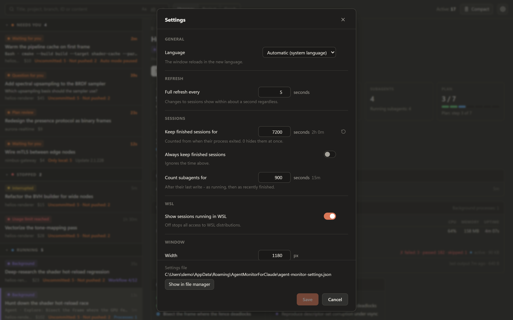

# Configuration

All settings are optional.

## Settings dialog

Click the gear in the toolbar, or press *Ctrl+,*, to change the settings. Changes apply when you save. A new language reloads the window, and the window size applies at the next start. A field that differs from its default shows a button that resets it.



## Settings file

The dialog saves to `agent-monitor-settings.json`:

- Windows: `%APPDATA%\AgentMonitorForClaude\agent-monitor-settings.json`
- Linux: `~/.config/agent-monitor-for-claude/agent-monitor-settings.json` (or under `$XDG_CONFIG_HOME` if set)

If a file named `agent-monitor-settings.json` is next to the executable (or in the project root when running from source), it is used instead, and the dialog saves to it. Use this for a portable setup.

A settings file in `~/.claude/` or `$CLAUDE_CONFIG_DIR` from an earlier version is still read. The first save moves its settings to the location above and leaves the old file unchanged.

You can edit the file by hand; the app reads it at start. Only values that differ from the default are written. Keys starting with `_` are kept as comments. An invalid entry uses its default, is reported at start and in the dialog, and is removed when you save.

## Options

| Key | Type | Default | Description |
|-----|------|---------|-------------|
| `poll_interval` | integer (1 - 3600) | `5` | Seconds between full refreshes. Changes to sessions are picked up within about a second regardless. |
| `ended_max_age` | integer (>= 0) | `3600` | How long (seconds) a finished session stays visible after its process exits. For sessions that ended before Agent Monitor started, counted from their last activity. |
| `include_completed` | boolean | `false` | Show finished sessions regardless of `ended_max_age`. |
| `wsl` | boolean | `true` | Windows only. List Claude Code sessions running inside WSL distributions. `false` turns off all WSL access. |
| `subagent_recent_seconds` | integer (>= 1) | `900` | How long (seconds) a subagent is counted after its last write - as running, then as recently finished. |
| `window_width` | integer (320 - 10000) | `1180` | Window width at start, in logical pixels. |
| `window_height` | integer (240 - 10000) | `760` | Window height at start, in logical pixels. |
| `language` | string | `""` | Force a language by locale code (see below). Empty means auto-detect from the system locale. |

## Example

```json
{
    "poll_interval": 3,
    "include_completed": true,
    "window_width": 1100,
    "language": "de"
}
```

## Languages

`language` accepts any locale code that has a matching file in `locale/`:

`en`, `de`, `es`, `fr`, `hi`, `id`, `it`, `ja`, `ko`, `pt-BR`, `uk`, `zh-CN`, `zh-TW`.

## Token pricing

Costs are computed from `pricing.json` (in the repository root, or bundled with the Windows executable). Prices are never fetched online; edit the file when Anthropic's prices change.

Top-level keys are **effective-from dates** (`YYYY-MM-DD`). The latest date on or before today applies, so a future price change can be entered in advance. Each date holds a table of `model -> rates` in US dollars per million tokens. In this example, the second date is an invented price change:

```json
{
    "1970-01-01": {
        "opus-5-5":  { "input": 4, "output": 20, "cache_read": 0.20, "cache_write_5m": 5,    "cache_write_1h": 8 },
        "sonnet-5":  { "input": 2, "output": 10, "cache_read": 0.20, "cache_write_5m": 2.50, "cache_write_1h": 4 }
    },
    "2027-01-01": {
        "opus-5-5":  { "input": 4, "output": 20, "cache_read": 0.20, "cache_write_5m": 5,    "cache_write_1h": 8 },
        "sonnet-5":  { "input": 3, "output": 15, "cache_read": 0.30, "cache_write_5m": 3.75, "cache_write_1h": 6 }
    }
}
```

- Each date **fully replaces** the previous one. List **every** model in each table, including unchanged ones (like `opus-5-5` above).
- **Model keys** are the model id without `claude-`, `[tier]` and a trailing date: `claude-opus-4-8[1m]` becomes `opus-4-8`, `claude-haiku-4-5-20251001` becomes `haiku-4-5`.
- Enter all five rates as published; no multipliers are applied.
- A session using an unlisted model shows a token count instead of a cost.
- `web_search` is the price of one web search in US dollars (`{ "per_request": 0.01 }`). Repeat it in each table; without it, web searches are not counted.
- A `_comment` key is ignored.
